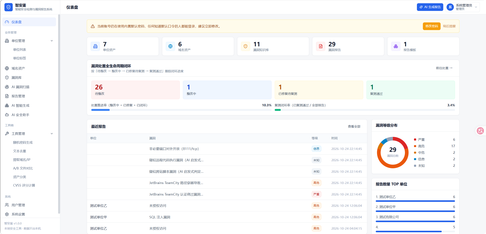
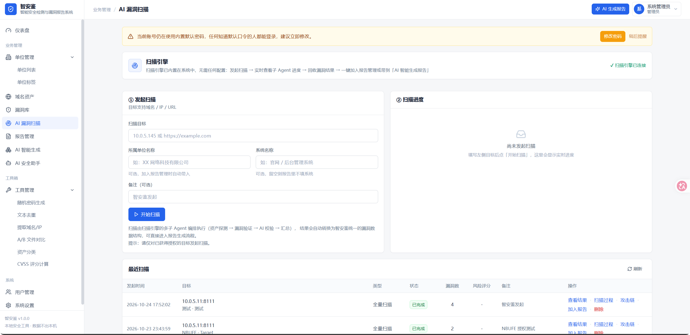

# 智安鉴 · 智能安全检测与漏洞报告系统

> AI 赋能 · 资产管理 · 漏洞治理 · 报告一键生成
> 基于大模型与 RAG 的智能安全检测与漏洞报告系统（Flask + React + MySQL，内置漏洞扫描引擎）



## 仓库内容

| 目录 / 文件 | 说明 |
|---|---|
| `智安鉴＋智安鉴源码/` | 完整源码（业务系统 + React 前端 + 内置扫描引擎 + 便携版 MySQL），详见其内 [README.md](智安鉴＋智安鉴源码/README.md) |
| `智安鉴＋智安鉴源码/启动智安鉴终稿.bat` | **Windows 一键启动（推荐）**：自动装依赖、起内置 MySQL（3307 端口，root 空密码）、打开 http://127.0.0.1:8742 |
| `智安鉴+作品报告.docx / .pdf` | 项目作品报告（七章结构） |
| `智安鉴+PPT.pptx / .pdf` | 项目展示 PPT（16:9） |
| `智安鉴+演示视频.mp4` | 功能演示视频（约 3 分 46 秒，中文讲解 + 字幕） |
| `智安鉴+系统运行截图/` | 全套系统运行截图（17 张），另附 zip 打包 |
| `智安鉴+智安鉴源码.zip` | 源码离线打包 |

## 两种运行方式

**① Windows 离线一键版（最简单）**

进入 `智安鉴＋智安鉴源码/` 双击 `启动智安鉴终稿.bat`——脚本自动识别 Python 3.10+、首次运行自动装依赖、启动目录内自带的便携版 MySQL（3307 端口），随后打开 http://127.0.0.1:8742 ，开箱即用。

**② Docker 全栈版（含扫描引擎）**

```bash
cd 智安鉴＋智安鉴源码
cp config.example.json config.json
docker compose up -d --build
# 8080 智安鉴 / 3000 引擎前端 / 8000 引擎 API / 8888 Kali 工具容器
```

更多说明（AI 接口配置、报告模板自定义、前端开发、数据安全、自动化测试等）见 [`智安鉴＋智安鉴源码/README.md`](智安鉴＋智安鉴源码/README.md) 与 [`智安鉴＋智安鉴源码/使用说明.md`](智安鉴＋智安鉴源码/使用说明.md)。



## 核心能力一览

- **AI 漏洞扫描**：内置扫描引擎一键全量扫描，实时查看子 Agent 进度、过程日志与攻击链，结果一键加入报告管理
- **AI 智能生成**：扫描器原始数据 → 结构化报告 → Word/PDF 一键导出，本地漏洞知识库 RAG 检索增强
- **扫描器导入**：Nuclei（JSONL/JSON）、通用 JSON、纯文本结果自动解析入库
- **报告质量体检**：九维加权规则引擎 0–100 分自动评分 + AI 专家点评
- **AI 安全助手**：SSE 流式多轮对话、漏洞分析、整改建议、多语言修复代码生成
- **CVSS v3.1 评分器**：严格遵循 FIRST.org 标准，实时算分、向量字符串双向解析
- **报告模板**：上传任意成品报告 docx 一键逆向成可复用模板，Word/PDF 多版式导出
